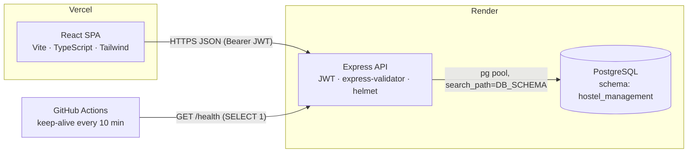

# Hostel Hub: Hostel Room Allotment System

Room applications, bed-level allocation, fee tracking and maintenance complaints for campus hostels, with a self-service portal for students and a console for wardens.

**Live demo:** Frontend: `https://<your-app>.vercel.app` (placeholder) · API: `https://hostel-management-api.onrender.com/health` (placeholder)

| Role | Login | Password |
| --- | --- | --- |
| Student | `STU2024001` | `student123` |
| Warden (super admin) | `superadmin` | `admin123` |

The demo runs on free tiers, so the first request after a quiet spell can take 30 to 60 seconds while the API wakes up. The UI shows a banner while that happens.

## Features

**Students**
- Browse rooms with free beds, filtered to the blocks open to them (gender-specific or mixed)
- Apply with block, room-type, move-in date and duration preferences; cancel while pending
- See their room, bed number, roommates, warden contact and stay history
- Fee history (deposit and monthly rent) with outstanding dues
- Raise maintenance complaints linked to their room and read the warden's reply
- Edit contact details and change their password

**Wardens / admins**
- Dashboard: occupancy by block, pending queue, open tickets, collections this month
- Applications queue: allot a specific bed, waitlist or reject with a note
- Rooms board: every room with bed pips, status filters, add rooms and blocks, maintenance holds
- Allocations: create, end a stay (the bed is released automatically)
- Students: search, deactivate/reactivate
- Fees: record payments, mark pending charges as received
- Complaints: triage by status and priority, reply to the student

**Rules the database enforces**
- One active allocation per student (partial unique index)
- Occupied beds can never exceed capacity (CHECK constraint plus an occupancy trigger), so two wardens can't both take the last bed
- Gender-specific blocks and maintenance/reserved rooms are rejected at allocation time

## Screenshots

| | |
| --- | --- |
|  |  |
|  |  |
|  |  |
|  |  |
|  |  |

## Architecture



- The frontend calls the API at `VITE_API_URL`. CORS only allows the origins in `FRONTEND_URL`.
- Several portfolio apps share one Render Postgres database. This app keeps every table in its own schema (`DB_SCHEMA`, default `hostel_management`), and the pool pins `search_path` to it.
- Migrations (`backend/db/migrations/*.sql`) and an idempotent demo seed run on every boot (`npm run start:prod`), because the free plan has no pre-deploy hook.

## Tech stack

| Layer | Tools |
| --- | --- |
| Frontend | React 19, React Router 7, TanStack Query 5, Tailwind CSS 4, Vite 8, TypeScript, lucide-react, sonner |
| Backend | Node.js, Express 4, pg, express-validator, jsonwebtoken, bcryptjs, helmet, express-rate-limit |
| Database | PostgreSQL 16 (plain SQL migrations, plpgsql triggers) |
| Quality | Jest + Supertest (API against a real Postgres schema), Vitest, ESLint 10, Prettier, GitHub Actions |
| Hosting | Vercel (frontend), Render web service + Render PostgreSQL (backend) |

## Local setup

Prerequisites: Node 20+ and a PostgreSQL database (any local Postgres or Docker container works).

```bash
# 1. Install
npm run install:all

# 2. Configure the API
cp backend/.env.example backend/.env      # edit DATABASE_URL and JWT_SECRET
cp frontend/.env.example frontend/.env    # VITE_API_URL=http://localhost:5124

# 3. Create the schema, run migrations and load demo data
npm run setup:db

# 4. Run both apps (two terminals)
npm run dev             # API on http://localhost:5124
npm run dev:frontend    # UI  on http://localhost:5212
```

Other scripts: `npm run lint`, `npm test` (backend tests rebuild the `hostel_management_test` schema), `npm run build`, `npm run format`.

## Environment variables

**Backend (`backend/.env`, Render)**

| Variable | Required | Default | Description |
| --- | --- | --- | --- |
| `DATABASE_URL` | yes | | Postgres connection string (use Render's internal URL in production) |
| `DB_SCHEMA` | no | `hostel_management` | Schema that holds this app's tables |
| `DATABASE_SSL` | no | `false` | `true` when connecting over Render's external URL |
| `JWT_SECRET` | yes | | Secret for signing access tokens (Render generates it) |
| `JWT_EXPIRE` | no | `24h` | Token lifetime |
| `FRONTEND_URL` | prod | `http://localhost:5212` | Comma-separated allowed CORS origins |
| `PORT` | no | `5124` | Render sets this automatically |
| `NODE_ENV` | no | | `production` hides error details |
| `BCRYPT_ROUNDS` | no | `10` | Password hashing cost |
| `RATE_LIMIT_MAX_REQUESTS` | no | `300` | Requests per IP per 15 min (auth routes are capped at 20) |
| `DEMO_MODE` | no | `false` | `true` stops visitors from changing the demo student's password or deactivating it |

**Frontend (`frontend/.env`, Vercel)**

| Variable | Description |
| --- | --- |
| `VITE_API_URL` | Base URL of the API, e.g. `https://hostel-management-api.onrender.com` |

## Deployment

**1. Database (once, shared).** Use the existing shared Render PostgreSQL instance, or create one free instance. Copy its *Internal Database URL*.

**2. API on Render.**
1. Render dashboard → **New → Blueprint** → select this repo. `render.yaml` declares the `hostel-management-api` web service (root `backend`, health check `/health`).
2. When prompted, set `DATABASE_URL` to the shared database's internal URL, and `FRONTEND_URL` to your Vercel URL (you can fill this in after step 3).
3. Deploy. On boot the service creates the `hostel_management` schema, applies migrations, seeds the demo data once and starts. Check `https://<service>.onrender.com/health` → `{"status":"ok","db":"ok"}`.

**3. Frontend on Vercel.**
1. **Add New → Project** → import this repo → set **Root Directory** to `frontend` (framework: Vite).
2. Add the env var `VITE_API_URL` = your Render API URL, then deploy. `vercel.json` handles SPA rewrites and security headers.
3. Put the Vercel URL in the API's `FRONTEND_URL` on Render and redeploy the API.

**4. Keep-alive.** In GitHub → *Settings → Secrets and variables → Actions → Variables*, add `BACKEND_URL` = the Render API URL. `.github/workflows/keep-alive.yml` pings `/health` every 10 minutes so the free instance (and its DB connection) stays warm. Without the variable the job skips cleanly.

## Project structure

```
.
├── backend/                 Express API (Render rootDir)
│   ├── config/database.js   pg pool, search_path, ? → $n placeholder helper
│   ├── controllers/         student + admin request handlers
│   ├── db/
│   │   ├── migrations/      001_init.sql, 002_complaints.sql
│   │   ├── migrate.js       applies pending migrations (advisory-locked)
│   │   └── seed.js          idempotent demo data
│   ├── middleware/          JWT auth, express-validator rules
│   ├── routes/              /api/students/*, /api/admin/*
│   ├── tests/               Jest + Supertest
│   └── server.js            app, /health, CORS, helmet, rate limits, error handler
├── frontend/                React SPA (Vercel root directory)
│   ├── src/components/      design-system primitives, layout, modals
│   ├── src/lib/             API client, auth context, formatting, types
│   └── src/pages/           landing, auth, student/*, admin/*
├── scripts/setup-database.js  local migrate + seed
├── docs/screenshots/
├── Report/                  original academic project report (PDF/DOCX)
├── render.yaml              Render Blueprint
└── .github/workflows/       ci.yml, keep-alive.yml
```

## Author

**Harsh Bathija** · [GitHub](https://github.com/HarshBathija-04)

Licensed under the [MIT License](LICENSE).
