# Hostel Hub

**Hostel room allotment, bed by bed.** Students apply for rooms, pay fees and raise maintenance tickets; wardens allot beds, track dues and close complaints, all from one React + Express + PostgreSQL app.

[](https://github.com/HarshBathija-04/Hostel-management/actions/workflows/ci.yml)


[](LICENSE)

**Live demo:** `https://<your-app>.vercel.app` (placeholder) · **API health:** `https://hostel-management-api.onrender.com/health` (placeholder)

| Role | Login | Password |
| --- | --- | --- |
| Student | `STU2024001` | `student123` |
| Warden (super admin) | `superadmin` | `admin123` |

Both logins are pre-filled on the sign-in screens. The demo runs on free tiers, so the first request after a quiet spell can take up to a minute while the API wakes up; the UI shows a banner while it does.

## Features

- **Room finder:** students only see rooms with free beds in blocks open to them (gender-specific or mixed).
- **Applications:** apply with block, room type, move-in date and duration; wardens allot a bed, waitlist or reject with a note the student reads.
- **Bed-level rooms board:** every room shows occupied and free beds, with status filters and maintenance holds.
- **My room:** bed number, roommates, warden contact and stay history.
- **Fees:** deposits and monthly rent per stay, outstanding dues, payments marked as received.
- **Complaints:** tickets linked to the student's room, triaged by status and priority, with warden replies.
- **Admin console:** live occupancy by block, pending queue, open tickets and collections this month.

## Screenshots

| | |
| --- | --- |
| 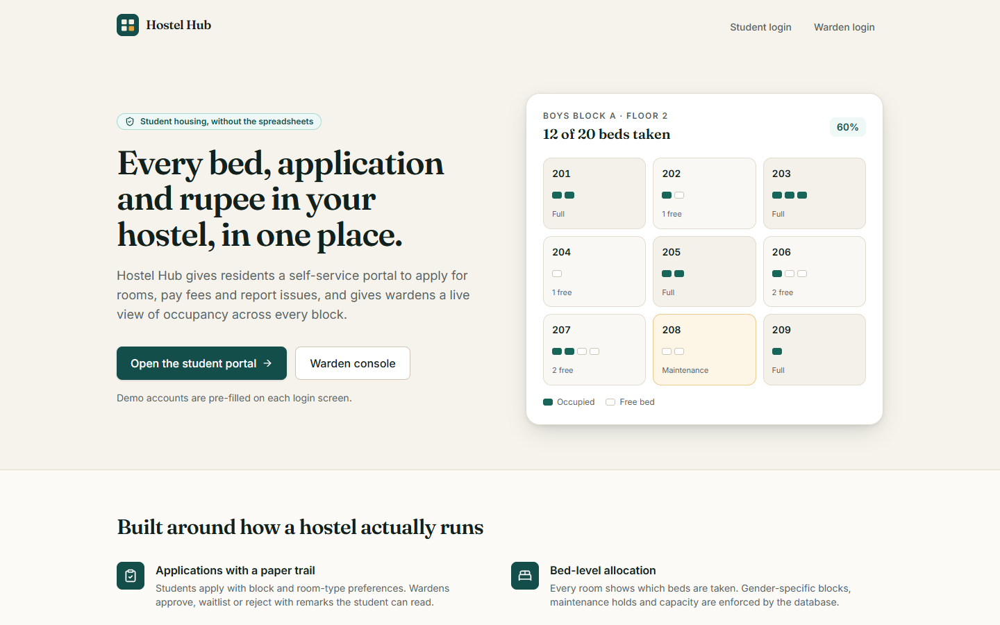 | 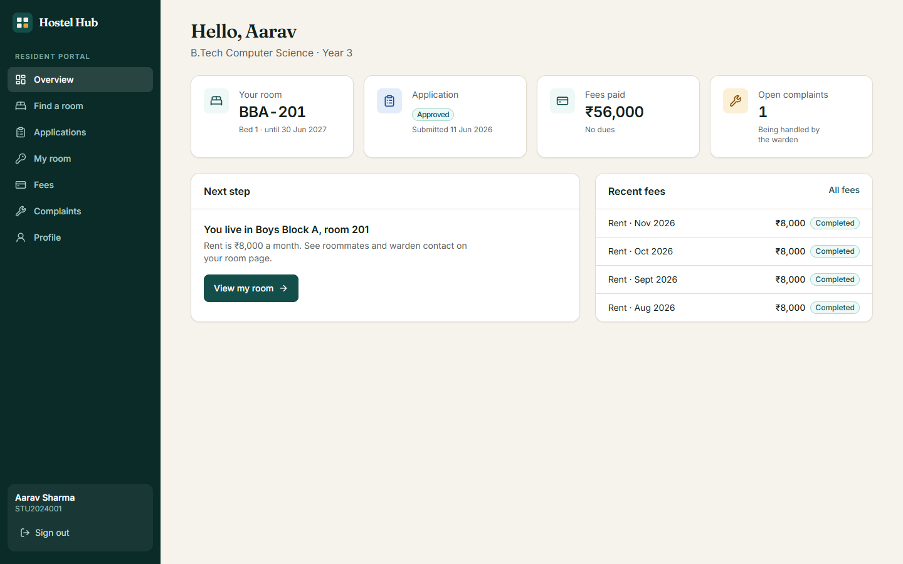 |
| 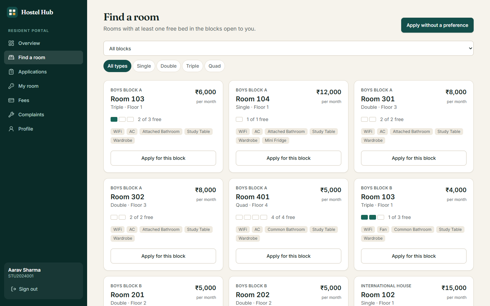 | 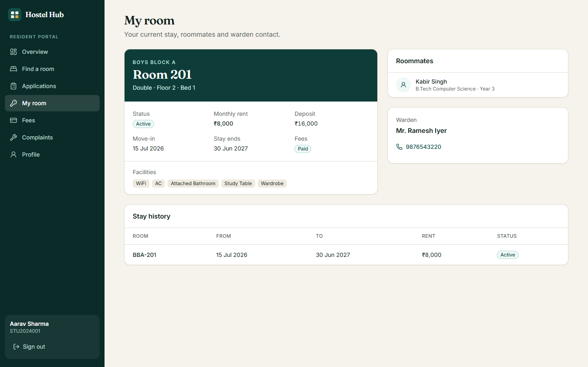 |
| 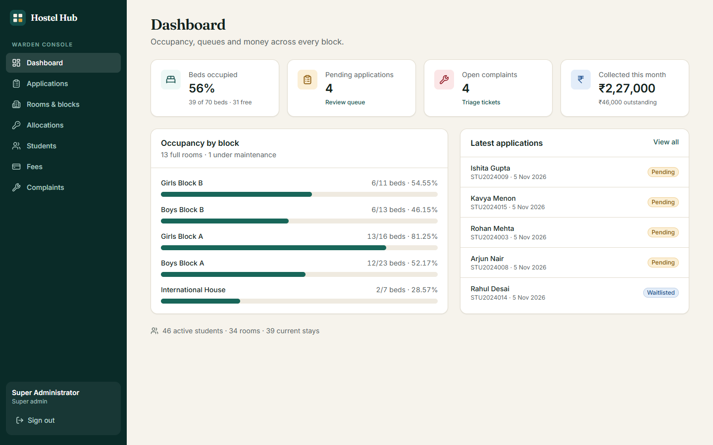 | 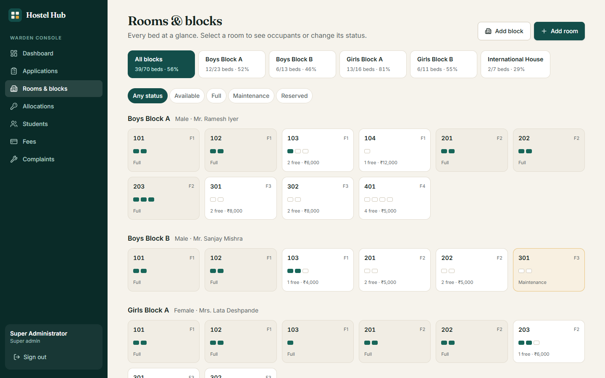 |
| 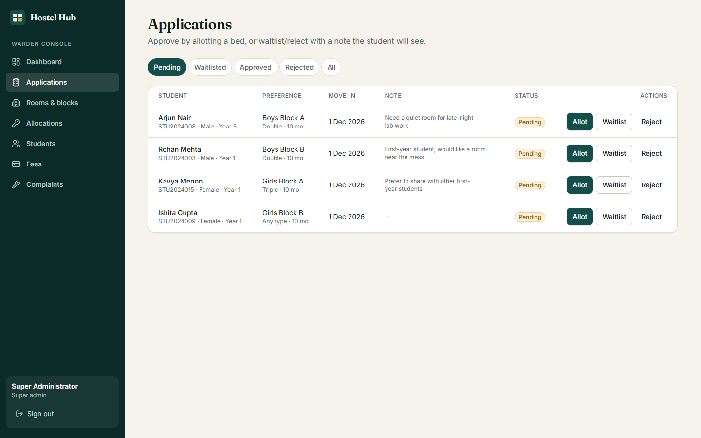 | 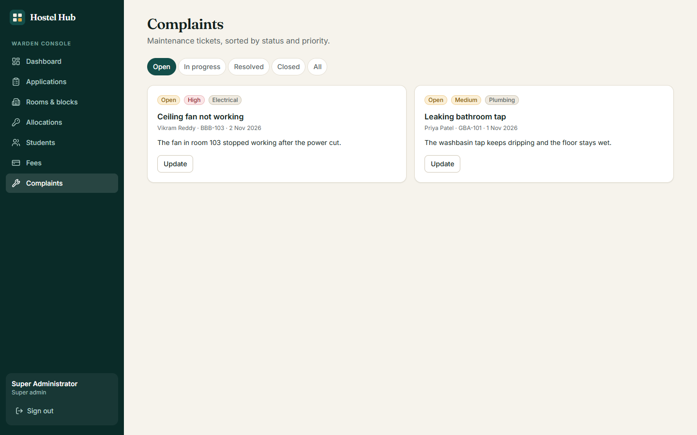 |
| 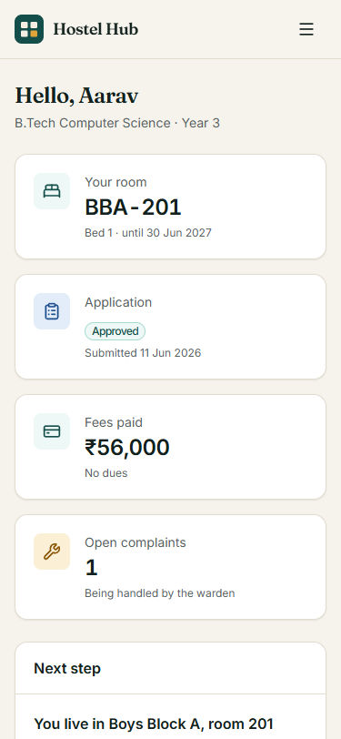 | 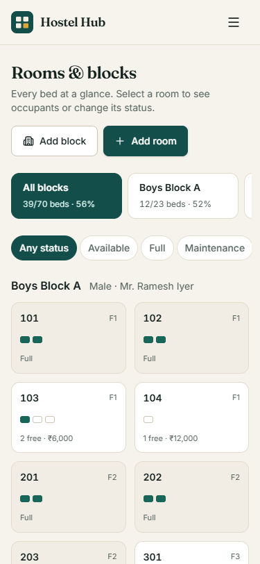 |

## Architecture

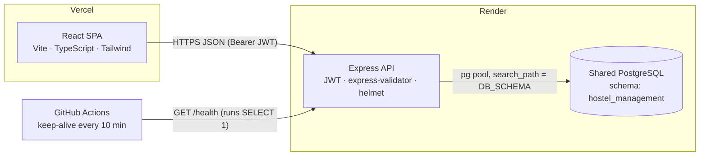

## Engineering highlights

- **Bookings that cannot overbook.** A plpgsql trigger keeps `rooms.occupied_beds` in step with active allocations, and a `CHECK (occupied_beds BETWEEN 0 AND capacity)` makes the database reject a second warden taking the last bed. A partial unique index allows only one active stay per student.
- **Transaction-safe allotment.** Creating an allocation and approving its application run in one transaction, so a failure never leaves an approved application without a bed.
- **Schema-per-app on a shared database.** Several portfolio apps share one free Render Postgres. This app keeps every table in its own schema (`DB_SCHEMA`), the pool pins `search_path` to it, and the schema name is validated before use.
- **Migrations on boot.** Plain SQL migrations are applied once each under a Postgres advisory lock, followed by an idempotent demo seed, because Render's free plan has no pre-deploy hook. CI checks that both run twice without changes.
- **Real-database tests.** Jest + Supertest drive the API against a throwaway Postgres schema rebuilt for every run: auth, role checks, the apply-allot-terminate flow and capacity rules.
- **Defence in depth.** helmet, a strict CORS allow-list, rate limits (20 auth attempts per 15 minutes), express-validator on every write, bcrypt hashing, and Postgres errors mapped to clean 4xx responses. `DEMO_MODE` stops visitors locking out the shared demo account.
- **Cold-start aware UI.** The fetch client flags requests slower than 4 seconds and shows a "waking up the server" banner instead of a silent spinner.

## Tech stack

| Layer | Tools |
| --- | --- |
| Frontend | React 19, React Router 7, TanStack Query 5, Tailwind CSS 4, Vite 8, TypeScript, lucide-react, sonner |
| Backend | Node.js 20+, Express 4, pg, express-validator, jsonwebtoken, bcryptjs, helmet, express-rate-limit |
| Database | PostgreSQL 16 (plain SQL migrations, plpgsql triggers) |
| Quality | Jest + Supertest, Vitest, ESLint, Prettier, GitHub Actions |
| Hosting | Vercel (frontend), Render web service + shared Render PostgreSQL |

## Quick start

Prerequisites: Node 20+ and a PostgreSQL database. No local Postgres? Start one with Docker:

```bash
docker run -d --name hostel-pg -p 5433:5432 -e POSTGRES_PASSWORD=postgres -e POSTGRES_DB=portfolio postgres:16-alpine
```

Then:

```bash
npm run install:all
cp backend/.env.example backend/.env      # points at the Docker database above; change JWT_SECRET
cp frontend/.env.example frontend/.env    # VITE_API_URL=http://localhost:5124
npm run setup:db                          # creates the schema, runs migrations, loads demo data
npm run dev                               # API on http://localhost:5124
npm run dev:frontend                      # UI on http://localhost:5212 (second terminal)
```

Open http://localhost:5212 and sign in with a demo account. Other scripts: `npm run lint`, `npm test` (backend tests rebuild the `hostel_management_test` schema), `npm run build`, `npm run format`.

## Environment variables

**Backend** (`backend/.env` locally, Render in production)

| Variable | Required | Default | Description |
| --- | --- | --- | --- |
| `DATABASE_URL` | yes | | Postgres connection string (Render: the shared database's internal URL) |
| `DB_SCHEMA` | no | `hostel_management` | Schema that holds this app's tables |
| `DATABASE_SSL` | no | `false` | `true` when connecting over Render's external URL |
| `JWT_SECRET` | yes | | Secret for signing access tokens (the Blueprint generates one) |
| `JWT_EXPIRE` | no | `24h` | Token lifetime |
| `FRONTEND_URL` | in prod | `http://localhost:5212` | Comma-separated allowed CORS origins |
| `PORT` | no | `5124` | Render sets this automatically |
| `NODE_ENV` | no | | `production` hides error details and uses combined logs |
| `BCRYPT_ROUNDS` | no | `10` | Password hashing cost |
| `RATE_LIMIT_MAX_REQUESTS` | no | `300` | API requests per IP per 15 minutes |
| `DB_POOL_MAX` | no | `10` | Maximum pooled connections |
| `DEMO_MODE` | no | `false` | `true` blocks password changes and deactivation for the demo student |

**Frontend** (`frontend/.env` locally, Vercel in production)

| Variable | Description |
| --- | --- |
| `VITE_API_URL` | Base URL of the API, e.g. `https://hostel-management-api.onrender.com` |

## Deploy

1. **Database (shared, created once).** Reuse the shared Render PostgreSQL instance and copy its *Internal Database URL*. This app only ever touches its own `DB_SCHEMA`.
2. **API on Render.** Dashboard → **New → Blueprint** → pick this repo. `render.yaml` defines the `hostel-management-api` web service (root `backend`, health check `/health`, `DB_SCHEMA=hostel_management`). When prompted, set `DATABASE_URL` to the shared database's internal URL and `FRONTEND_URL` to your Vercel URL (fill it in after step 3). On boot it applies migrations, seeds the demo once and starts; `/health` should return `{"status":"ok","db":"ok"}`.
3. **Frontend on Vercel.** **Add New → Project** → import this repo → **Root Directory** `frontend` (Vite preset). Set `VITE_API_URL` to the Render API URL and deploy. `vercel.json` adds SPA rewrites and security headers. Then put the Vercel URL in the API's `FRONTEND_URL` and redeploy the API.
4. **Keep-alive.** GitHub → *Settings → Secrets and variables → Actions → Variables* → add `BACKEND_URL` = the Render API URL. `.github/workflows/keep-alive.yml` pings `/health` every 10 minutes so the free instance stays warm; without the variable the job skips.

## Project structure

```
.
├── backend/                   Express API (Render root directory)
│   ├── config/database.js     pg pool, search_path, ? → $n placeholders, transactions
│   ├── controllers/           student and admin handlers
│   ├── db/migrations/         001_init.sql, 002_complaints.sql
│   ├── db/migrate.js          applies pending migrations under an advisory lock
│   ├── db/seed.js             idempotent demo data
│   ├── middleware/            JWT auth, express-validator rules
│   ├── routes/                /api/students/*, /api/admin/*
│   ├── utils/helpers.js       responses, pagination, SQL filter builders
│   ├── tests/                 Jest + Supertest against a test schema
│   └── server.js              app, /health, CORS, helmet, rate limits, error handler
├── frontend/                  React SPA (Vercel root directory)
│   └── src/
│       ├── components/        UI primitives, app shell, modals
│       ├── lib/               API client, auth context, formatting, types
│       └── pages/             landing, auth, student/*, admin/*
├── scripts/setup-database.js  local migrate + seed
├── docs/screenshots/
├── Report/                    original academic project report (PDF/DOCX)
├── render.yaml                Render Blueprint
└── .github/workflows/         ci.yml, keep-alive.yml
```

## Author

**Harsh Bathija** · [GitHub](https://github.com/HarshBathija-04) · Licensed under the [MIT License](LICENSE).
